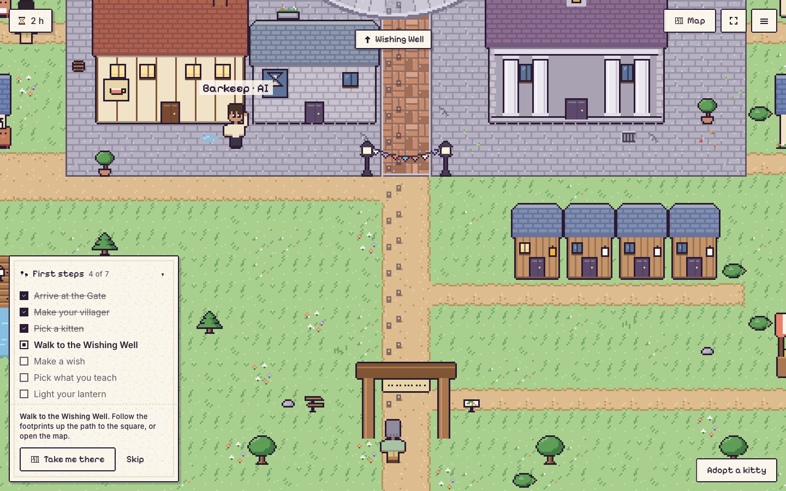
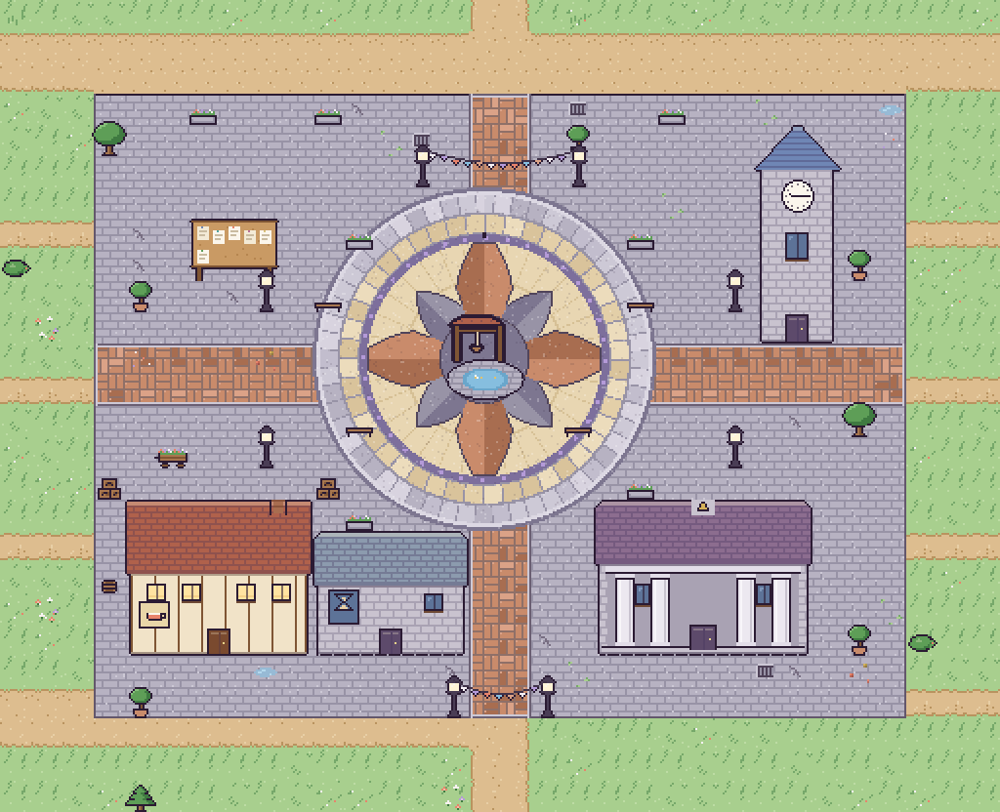
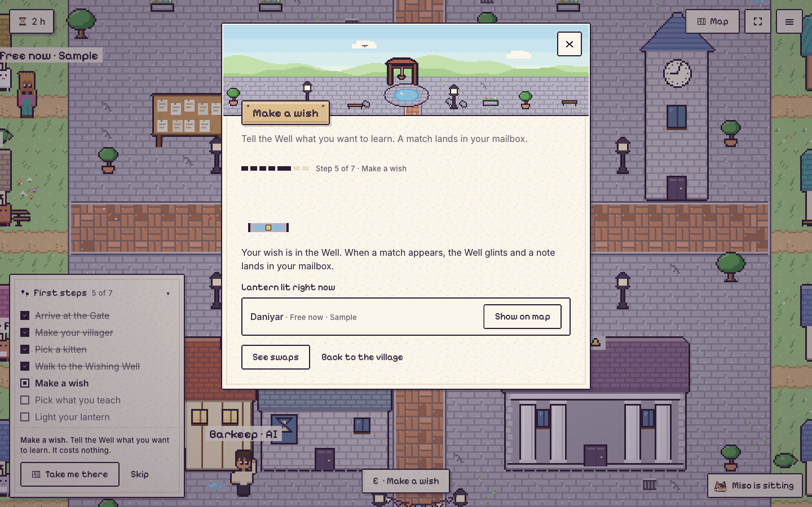
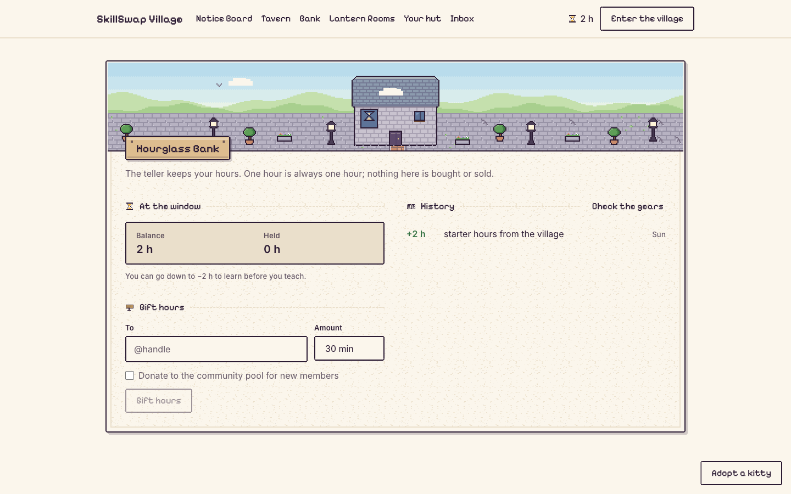

# SkillSwap Village

A time bank for skills, as a small pixel village: teach for an hour, earn an hour, spend it learning anything from anyone. One hour always equals one hour, and hours are never bought or sold.


You arrive at the Gate, make a villager, pick a kitten, and walk into a top-down village where every place is a feature: the **Wishing Well** takes learning requests, the **Notice Board** lists who teaches what, **The Swapped Mug** seats you at tables that are swap cycles, the **Hourglass Bank** keeps your hours, the **Clock Tower** audits the public ledger, and **Lantern Rooms** host the video lessons. A lit lantern in a hut window means that member can teach you right now.

Walking is optional: every place is one click away on the map, `/` searches everything, and **Plain mode** shows the same village as ordinary pages for keyboards, screen readers and small phones.

The designs: [System architecture](./SkillSwap%20—%20System%20Architecture.md) · [Village UI](./skillswap-village-ui.md) · [Gamification](./Gamification.md).

| | |
| --- | --- |
|  |  |
|  |  |

## Run it

```bash
npm install
npm run dev          # http://localhost:3000
```

No database to install: locally the app uses embedded Postgres (PGlite) in `./.pglite`, migrates it, and seeds the 20-category taxonomy plus 36 labelled sample members on first start. Opening the site creates a guest identity in the browser with 2 starter hours; there is no sign-up.

For `npm run build && npm start`, set `APP_SECRET` (32+ random characters) in `.env.local`. Production refuses to sign sessions without it.

```bash
npm test             # unit, property (fast-check) and integration tests
npm run test:e2e     # a first visit through the village in a real browser, start to settled lesson
npm run typecheck && npm run lint
npm run db:reset     # wipe and reseed the local database (stop the dev server first)
```

## The village

| Piece | Where | Notes |
| --- | --- | --- |
| World | `ui/village/engine.ts` | Phaser 3 in a client-only island, loaded after the HUD. Tiled JSON map with 16 px tiles at whole-pixel zoom that fills any window; A* click-to-move; day and night follow your clock; lamps, chimneys and lit windows glow at night; pigeons, ducks and chickens are scenery, never people. |
| Art | `modules/village/art` | Every sprite is drawn in code: tiles, buildings, the mosaic plaza, palette-swapped villagers (16 × 32) and field kitties (16 × 16). `scripts/village-assets.ts` writes the tileset and map. |
| Presence | `modules/village/service.ts`, `hub.ts` | Free now / Busy / Away is chosen by the member; AFK and "in a lesson" are automatic. Positions stream over SSE at 8 Hz to people nearby. |
| Sheets | `app/(village)/@sheet` | Every place opens as a parchment sheet over the moving world (intercepting routes) with a live pixel vignette of the place; a direct visit gets the same page in Plain mode. |
| First steps | `ui/village/guide.tsx` | A spotlight tour of the HUD, a seven-step checklist with "Take me there", and footprints plus an edge arrow pointing to the next goal. |
| Accessibility | throughout | The canvas is `aria-hidden`; a live region announces what's nearby; reduced motion swaps walking for quick-travel; focus rings, 44 px targets, status always in words. |

## What is real

Everything the demo shows runs on live data through the same code paths a real member uses.

| Engine | Where | What it guarantees |
| --- | --- | --- |
| Hour ledger | `modules/ledger` | Double-entry (balances always sum to zero), SHA-256 hash chain, append-only trigger in the database, −2 h floor, nightly reconciliation |
| Session escrow | `modules/booking/machine.ts`, `policy.ts` | One state machine; hours are held at booking and captured only after both sides confirm with device signatures |
| Matching | `modules/matching` | Edge score = similarity × level fit × time overlap × trust × activity; swap cycles of 2–5 found by depth-limited search |
| Identity | `modules/identity`, `ui/device.ts` | Non-extractable ECDSA P-256 key per browser; sensitive actions are signed over their exact payload |
| Trust | `modules/trust` | Levels 0–3 from real counts; ratings weighted by distinct counterparts |
| AI concierge | `modules/ai` | Claude through the Vercel AI Gateway; drafts only, never acts. Without a key, a labelled rule-based parser takes over |

Sample members are labelled "Sample" everywhere. They accept requests, accept swap cycles and confirm sessions automatically, through the same domain functions and with their own signing keys, so one person can run the whole loop. Their history was created by running real sessions through the escrow at seed time; nothing was written to the ledger directly.

Anyone can verify the ledger by climbing the Clock Tower (`/tower`), or with their own code from `GET /api/v1/ledger?after=0` and `GET /api/v1/ledger/head`.

## Production

Deploys to Vercel with Postgres on Neon. Connect a Neon database to the project (Vercel → Storage → Neon) so `DATABASE_URL` is set, and add `APP_SECRET`. Every build runs `npm run db:deploy` first: it applies migrations over the direct connection and seeds the catalogue once (both idempotent), then `next build` runs. Without `DATABASE_URL` the build still succeeds and the app falls back to a temporary embedded database in `/tmp`, which is fine for a preview and not for real data.

Optional services each have a fallback: `AI_GATEWAY_API_KEY` (the Barkeep's language model; otherwise a labelled rule-based parser), `INNGEST_EVENT_KEY`/`INNGEST_SIGNING_KEY` (durable jobs; otherwise events are dispatched in-process), `UPSTASH_REDIS_REST_URL`/`_TOKEN` (shared rate limits), `CRON_SECRET` (the daily sweep in `vercel.ts`). See `.env.example`.

Known limits of a serverless deploy: live presence (who is walking where) is shared within one server instance rather than across all of them, since the realtime hub is in memory; the design calls for Ably channels here.

## The kitty (gamification)

Every member can adopt a one-of-a-kind pixel kitty that lives on the website, behaves like a real cat, and grows as its owner teaches and learns. The design is in [Gamification.md](./Gamification.md).

| Piece | Where | Notes |
| --- | --- | --- |
| Pixel rig | `modules/game/rig` | One parametric rig instead of hand-drawn frames: pixel-snapped parts, 1 px plum outlines, hue-shifted shading, 8 coat patterns by UV, 3 growth stages, 22 animations (105 frames per stage). Output is palette keys; colours are swapped per genome. `/dev/kitty` shows every gene, animation and item. |
| Genome | `modules/game/genome.ts` | Seeded from SHA-256(member id + server secret) with xoshiro128**; 622,080 visible combinations; a unique index guarantees no two kitties match. |
| Progression | `modules/game/service.ts` | XP only from settled, two-sided sessions (plus small capped amounts for reviews, gifts and care); 300/day and 60/week-per-counterpart caps; append-only XP log; levels 1–50; seven ranks that need real teaching and never drop. |
| Unlocks | `modules/game/catalog.ts`, `rules.ts` | 49 items in 9 slots and 16 badges, all data. Rules are evaluated on every XP event. |
| Behaviour | `ui/kitty` | Utility AI (needs, personality, time of day), perches on page elements marked `data-perch`, jumps by breadth-first search between them, petting, slow blinks, pick up and drop, toys, feeding, and reactions to settled sessions and level-ups. Runs at 10 fps while asleep, stops in hidden tabs, keeps one awake kitty across tabs, and stays in a corner with reduced motion. |

```bash
npx tsx scripts/kitty-sheet.ts sheet.png stages   # render a contact sheet of the rig
npm run test:e2e                                  # the demo moment in a real browser
```
