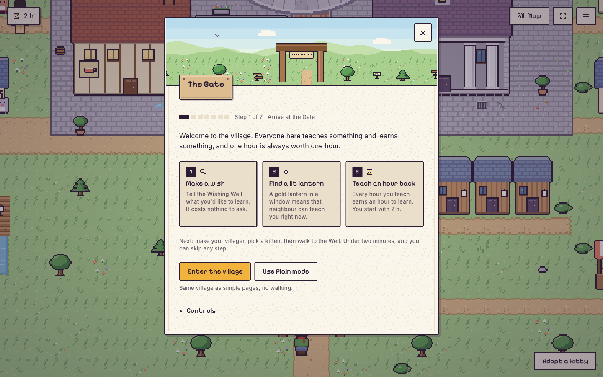

# SkillSwap Village

Teach someone for an hour and you earn an hour. Spend it learning anything from anyone else in the village.



**Try it:** [skillswap-jiga22.vercel.app](https://skillswap-jiga22.vercel.app). There's no sign-up. Your browser becomes your account, and you start with 2 hours to spend.

## The idea

Almost everyone knows something that someone else would love to learn. You might be good at spreadsheets and want to learn guitar. Somewhere nearby, a guitarist is stuck on a spreadsheet. Money usually sits between those two people and stops the trade from happening.

SkillSwap replaces the money with time. It's a time bank: when you teach for an hour, an hour lands in your balance, and you can spend it on a lesson from anyone. Every hour is worth exactly one hour, whether it's coding, cooking, Spanish or bike repair. Hours can't be bought, sold or gifted for cash. You can even go down to −2 h, so you can learn before you've taught anything.

## Why a village

A time bank on its own is a balance and a long list of names, which is accurate and a bit lifeless. So SkillSwap is a small pixel village you walk around in, and every feature is a place.

You make a wish at the Wishing Well. The Notice Board shows who teaches what. Each member has a hut in the lanes, and when someone's lantern is lit in the window, they're free to teach you right now. Gold means "now" everywhere in the village: lit lanterns and the buttons you can press this minute are the only gold things you'll see.

Walking is optional. Every place is one click away on the map, `/` searches everything, and Plain mode shows the same village as ordinary web pages for keyboards, screen readers and small phones.

| | |
| --- | --- |
|  |  |
|  |  |

## A first visit

1. You arrive at the Gate, make a villager and pick one of three kittens.
2. A short tour shows you around, and footprints lead you up the path to the Wishing Well.
3. You toss in a wish: "chords for one song on guitar". The Well points you to anyone teaching guitar whose lantern is lit.
4. You book half an hour. The half hour is held, not spent, so nothing is paid yet.
5. You both meet in a Lantern Room, a small study room with a video call.
6. Afterwards you each confirm the lesson happened, and only then does the half hour move to your teacher.

That's the whole loop. To earn more hours, you pick what you can teach and light your own lantern.

## Swaps at the tavern

Sometimes no single person wants what you offer, but a circle does. Say you teach Excel to Mira, Mira teaches guitar to Leo, and Leo teaches you Spanish. Nobody owes anybody: everyone teaches one hour and learns one. The matcher looks for these circles of two to five people, and each one shows up as a table in The Swapped Mug with a chair for you. The Barkeep behind the bar can explain why you were seated there. He's an AI, his nameplate says so, and he only ever drafts things for you to approve.

## Why you can trust it

Hours only move when both people confirm a lesson, and each confirmation is signed by a key that lives in that person's browser. Every hour that has ever moved is written into a public ledger where each entry carries the fingerprint of the one before it, so changing anything in the past breaks the chain. Anyone can check it by climbing the Clock Tower, which re-reads the whole ledger in your browser and tells you whether it holds.

Every person in the village is a real member. The demo includes sample members so you can try a full lesson on your own. They're labelled "Sample" everywhere, and they go through exactly the same steps as you, including the signatures.

## Your kitty

Every member adopts a one-of-a-kind pixel kitty. It sleeps on your hut's step, follows you around the village and grows as you teach and learn. Its XP comes only from real lessons, so it can't be farmed, and it's never worth hours or money.

## Under the hood

SkillSwap is a Next.js app with Postgres. The village is drawn with Phaser, and every sprite (tiles, buildings, villagers, kitties) is generated in code. The full designs are in the repo:

- [System architecture](./SkillSwap%20—%20System%20Architecture.md): the time bank, ledger, escrow, matching and trust model
- [Village UI](./skillswap-village-ui.md): the village, its places, the HUD and accessibility
- [Gamification](./Gamification.md): the kitty, XP and ranks

### Run it locally

```bash
npm install
npm run dev          # http://localhost:3000
```

You don't need to install a database. Locally the app runs Postgres inside Node (PGlite), creates the tables and fills the village with 36 labelled sample members the first time it starts. For `npm run build && npm start`, put an `APP_SECRET` of 32 or more random characters in `.env.local`.

```bash
npm test             # unit, property and integration tests
npm run test:e2e     # a full first visit in a real browser, from the Gate to a settled lesson
npm run typecheck && npm run lint
npm run db:reset     # wipe and reseed the local database (stop the dev server first)
```

### Deploy

The app deploys to Vercel with a Neon Postgres database. Connect Neon to the project from Vercel's Storage tab so `DATABASE_URL` is set, and add `APP_SECRET`. Each build runs `npm run db:deploy` first, which updates the database tables and seeds the village once (it's safe to run on every build), then builds the app. `vercel.ts` runs the functions in Frankfurt (`fra1`) because that's where this database lives; if you create yours in another region, change it to match, or every query pays for the distance. The optional services in [`.env.example`](./.env.example) each have a built-in fallback, so the app runs without them.

One limit of running on serverless functions: live presence (who's walking where) is shared within one server instance rather than across all of them. The design calls for a realtime service such as Ably for that.

### Where things live

| Part | Folder |
| --- | --- |
| The village world (Phaser), HUD, guide and sheets | `ui/village`, `app/(village)` |
| Pixel art, map and plaza | `modules/village/art`, `modules/village/map.ts` |
| Hour ledger and escrow | `modules/ledger`, `modules/booking` |
| Matching and swap circles | `modules/matching` |
| Trust and reviews | `modules/trust` |
| The Barkeep (AI) | `modules/ai` |
| Kitty and XP | `modules/game`, `ui/kitty` |
| Database schema, migrations and seed | `db` |
